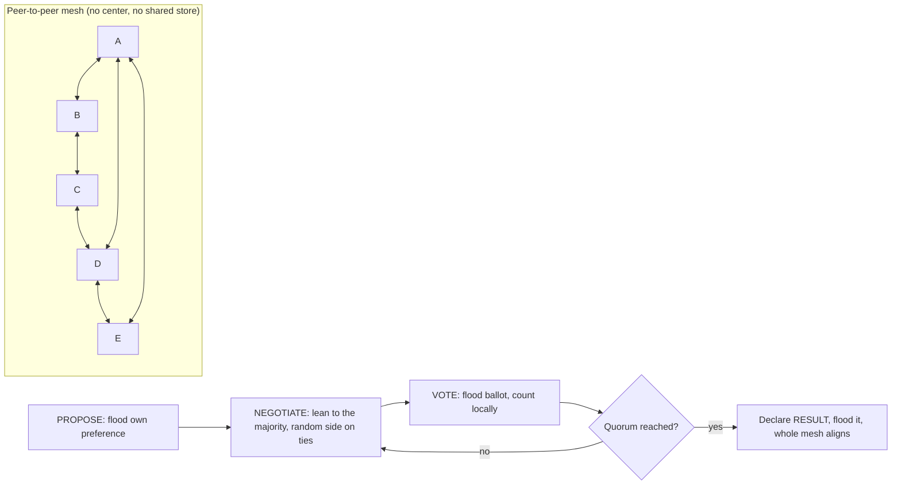

# Mesh-Decentralized Multi-Agent Architecture (P2P) Simulation

No supervisor, no shared blackboard — just a bunch of equal peers passing messages point-to-point until they talk themselves into agreement. This is a runnable companion to my blog post on the mesh decentralized (P2P) multi-agent architecture: every mechanism in that article is implemented here as working code.

 

## Introduction

Most multi-agent topologies keep some form of center: a pipeline has a fixed order, a star has a supervisor, a hierarchy has managers, a blackboard has a shared store. The mesh removes all of them. Agents talk directly over peer links, and global outcomes — task division, agreement on a plan — have to emerge from many local negotiations instead of being issued from above.

What got implemented:

- **Peer-to-peer messaging** — each node only knows its own neighbor table, that is the only routing info it gets (`PeerAgent.neighbors`);
- **Flooding with TTL decay** — forward to everyone except where the message came from, drop it at zero hops (`PeerAgent.process_inbox`);
- **Message dedup** — the same message arrives over several paths and gets processed exactly once, the first guard against message storms (`PeerAgent.seen_ids`);
- **Propose / negotiate / vote** — each node keeps its own tally, there is no central vote counter;
- **Local consensus declaration** — whoever's tally hits quorum first announces the result and floods it, the mesh aligns to the first result it hears (`check_consensus`);
- **Dynamic membership** — nodes crash and join mid-run, newcomers sync up through a HELLO that makes neighbors reply with a targeted RESULT (`remove_agent`, `join_network`);
- **Graceful failure** — sending to a dead node just fails, one lost link never takes the network down.

The demo: five peers of a game-playing swarm negotiate a unified strategy (attack / defend / guerrilla). Mid-run one node crashes and a new one joins, and both issues still converge. The final stats report total deliveries and dedup drops — the communication overhead this architecture is known for, right there in numbers.



## Dependencies

Python 3.8+ and the standard library — `random`, `uuid`, `collections`, `dataclasses`. Nothing to install.

## Project Structure

```text
mesh-decentralized-agents/
├── mesh_p2p_agents.py    # Peer agent, mesh network layer, consensus orchestration, demo flow
├── test_mesh_p2p.py      # Five test cases: dedup / TTL / consensus / node crash / newcomer sync
├── readme.md             # This file
└── readme_CN.md          # Chinese documentation
```

## Usage

Run the demo:

```bash
python mesh_p2p_agents.py
```

You get the whole lifecycle: mesh building, HELLO discovery, proposal/negotiation/vote rounds, consensus, a crash drill, newcomer sync, a second negotiation, and traffic stats.

Run the tests:

```bash
python test_mesh_p2p.py
```

All knobs sit at the top of `mesh_p2p_agents.py`:

| Constant | Default | Meaning |
|---|---|---|
| `V_消息最大跳数` | 5 | TTL: hops a message may traverse before being dropped |
| `V_共识通过票数` | 3 | Quorum: votes needed for any node to declare consensus |
| `V_单议题最大轮数` | 6 | Safety bound on negotiation rounds per issue |
| `V_初始节点数` | 5 | Number of initial peers |
| `V_每节点额外连边数` | 1 | Extra random edges beyond the ring backbone, on purpose not fully connected |
| `V_随机种子` | 42 | Fixed seed, runs stay reproducible |
| `V_详细日志` | `False` | `True` prints every hop of every message, verbose |

## Contributing

Found a bug or want to improve the consensus logic? Open an issue first so we can talk it over, then send a PR. Keep the current style — snake_case names, semicolon-terminated statements, short engineering-note comments — and make sure `python test_mesh_p2p.py` passes before submitting.

## Contact

**Dr. Ailan Anjuxi (谙弆悕博士)**

- GitHub: <https://github.com/anjuxi>
- 📫 Email: <anjuxi.ME@outlook.com>
- 📞 SIP: <sip:anjuxi@sip.linphone.org>

> © 2026 谙弆悕博士（Ailan Anjuxi），All rights reserved.
