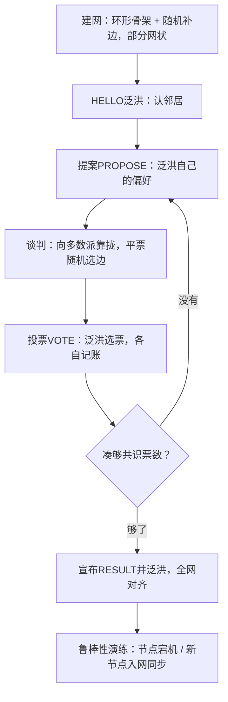

# 网状去中心化多智能体架构（Mesh P2P）仿真系统

没有主管，没有共享黑板——一群平权的节点点对点传消息，谈着谈着就谈拢了。本项目是我那篇网状去中心化（Mesh P2P）多智能体架构博文的配套实现，把里面的机制全部落成了能跑的代码。

 

## 项目介绍

大多数多智能体拓扑都留着某种"中心"：流水线有固定顺序，星型有主管，层级有上司，黑板有共享存储。网状把这些全拆了——节点之间点对点直连，全局结论不是谁下达的，只能从一次次局部谈判里磨出来。

落地了这些机制：

- **点对点通信**——每个节点只知道自己的邻居表，这就是它全部的路由信息（`PeerAgent.neighbors`）；
- **泛洪转发 + TTL衰减**——转发给除来源外的所有邻居，跳数归零就丢（`PeerAgent.process_inbox`）；
- **消息去重**——同一消息会从好几条路径挤进来，只处理一次，防消息风暴的第一道闸（`PeerAgent.seen_ids`）；
- **提案 / 谈判 / 投票**——每个节点自己记账，全网不存在中心计票员；
- **本地宣布共识**——谁的票箱先凑够票数谁宣布，RESULT泛洪出去，全网对齐先听到的结论（`check_consensus`）；
- **动态增减节点**——节点随时宕机、随时入网，新节点广播HELLO，邻居定向回传RESULT完成同步（`remove_agent`、`join_network`）；
- **优雅失败**——发往已下线节点的消息自然丢弃，断一条链路不影响全网。

演示场景：五个博弈节点协商统一策略（进攻/防守/游击）。中途一个节点宕机、一个新节点入网，两个议题照常收敛。收尾统计给出全网投递条数和去重拦截数——这套架构"通信开销大"的老毛病，直接用数字摆出来。



## 依赖说明

Python 3.8+，其余全是标准库——`random`、`uuid`、`collections`、`dataclasses`，不用装任何东西。

## 项目结构

```text
网状去中心化架构/
├── mesh_p2p_agents.py    # 对等节点、网状网络层、共识编排、主流程演示
├── test_mesh_p2p.py      # 五个测试用例：去重 / TTL / 共识 / 节点宕机 / 入网同步
├── readme.md             # 英文说明（主文档）
└── readme_CN.md          # 本文件
```

## 使用说明

跑演示：

```bash
python mesh_p2p_agents.py
```

能看到完整流程：建网、HELLO认邻居、提案/谈判/投票、共识收敛、宕机演练、新节点同步、议题二再谈一轮、流量统计。

跑测试：

```bash
python test_mesh_p2p.py
```

调参入口全在 `mesh_p2p_agents.py` 文件头：

| 常量 | 默认值 | 含义 |
|---|---|---|
| `V_消息最大跳数` | 5 | TTL，消息最多转发的跳数 |
| `V_共识通过票数` | 3 | 票数阈值，凑够就能宣布结论 |
| `V_单议题最大轮数` | 6 | 单议题协商轮数上限，兜底 |
| `V_初始节点数` | 5 | 初始入网节点数 |
| `V_每节点额外连边数` | 1 | 环形骨架外随机补的边数，故意不全连 |
| `V_随机种子` | 42 | 固定种子，每次跑结果一样 |
| `V_详细日志` | `False` | 置 `True` 打印每一跳投递，量大 |

## 贡献指南

发现bug或者想改共识逻辑，先开个Issue聊一下再动手提PR。保持现有风格——蛇形命名、语句分号结尾、注释是简短的工程笔记——提交前跑一遍 `python test_mesh_p2p.py` 确认全过。

## 联系作者

**谙弆悕博士（Ailan Anjuxi）**

- GitHub：<https://github.com/anjuxi>
- 📫邮箱：<anjuxi.ME@outlook.com>
- 📞SIP电话：<sip:anjuxi@sip.linphone.org>

> © 2026 谙弆悕博士（Ailan Anjuxi），All rights reserved.
